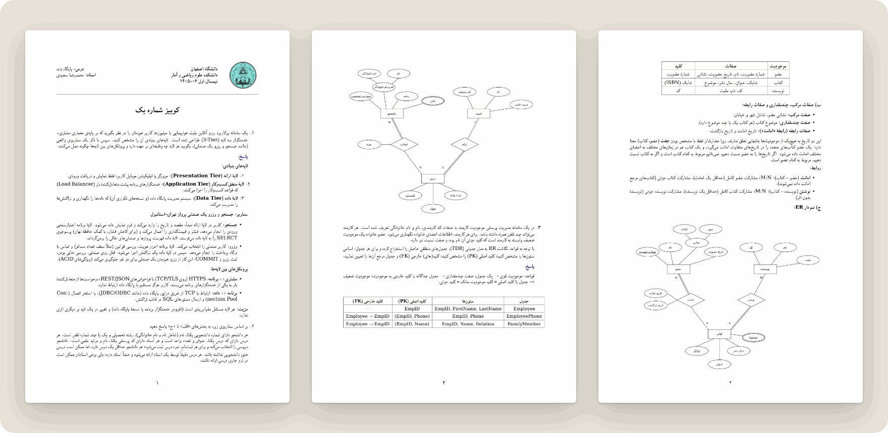

<picture>
  <source media="(prefers-color-scheme: dark)" srcset="../assets/banner-quizzes-dark.png">
  
</picture>

 

This folder holds the course quizzes. Each quiz comes in two sets with different questions on the same material. Both are published with full answers, and both are in Persian.

[Back to the course overview](../README.md)

## Quiz 1

| Set | Questions | File |
|:---|:---|:---|
| Set&nbsp;1 | Three-tier architecture for an airline booking system · ER diagram of a university (students, courses, professors) in Chen notation · Mapping an ER model with a multivalued attribute and a weak entity to tables | [Set 1 with answers](Database_Quiz1_Set1.pdf) |
| Set&nbsp;2 | Problems of file-based systems in a retail chain · ER diagram of a library (members, books, authors) in Chen notation · Designing tables with primary and foreign keys for departments, projects and employees | [Set 2 with answers](Database_Quiz1_Set2.pdf) |

The answers go further than the quiz asked. For the ER questions, the solutions also list entities, attribute types, cardinalities and participation constraints before drawing the diagram, so you can follow the reasoning step by step.

## Using the answers

Try each question on your own before reading the solution. The [lecture slides](<../Sources/course slides.pdf>) cover this material in Part 1 (architectures and file-based systems), Part 2 (ER modeling) and Part 3 (logical design).
