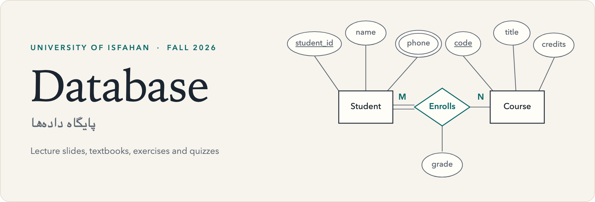
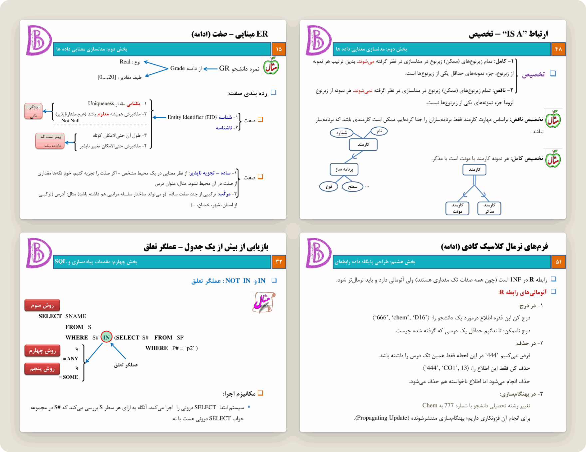
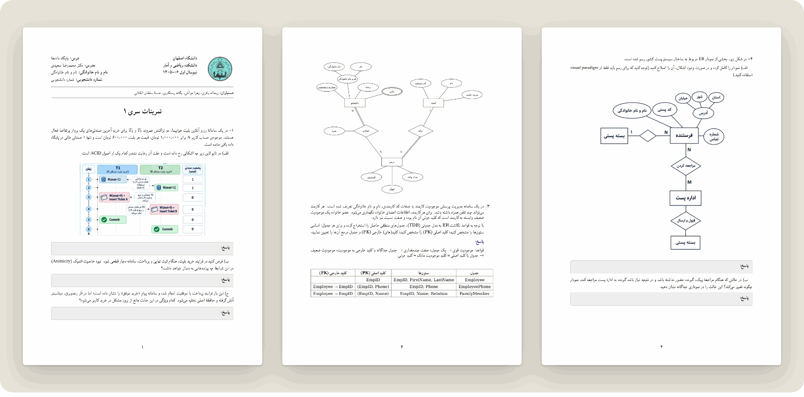
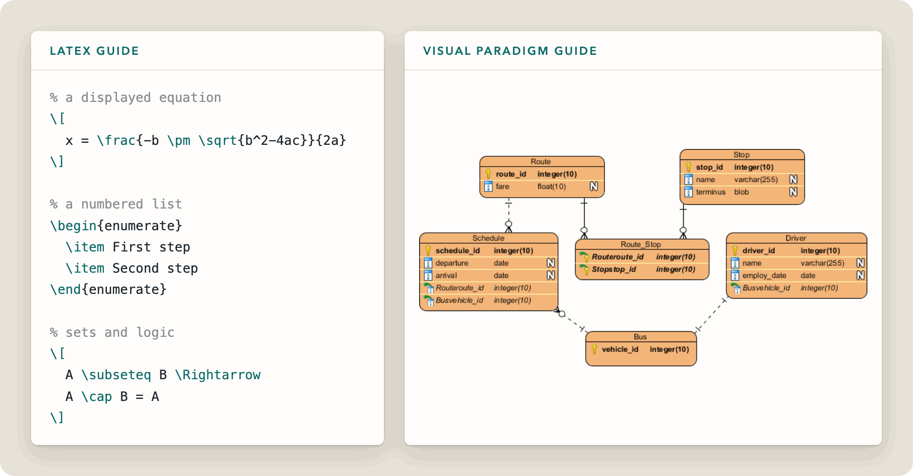
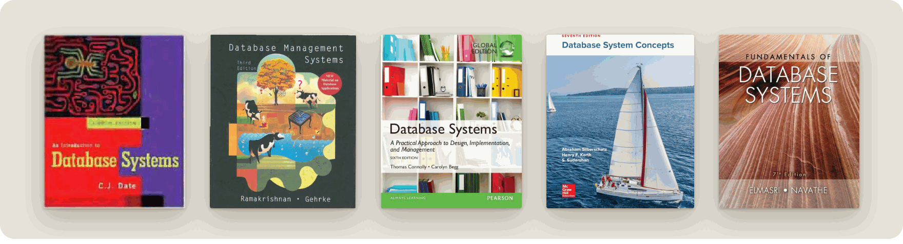

<picture>
  <source media="(prefers-color-scheme: dark)" srcset="assets/hero-dark.png">
  
</picture>

<br>

Course materials for **Database**, taught by Dr. Mohammadreza Saeidi at the [University of Isfahan](https://www.ui.ac.ir/) in Fall 2026 (semester 1405–06).

**[Slides and textbooks](Sources/)** &nbsp;·&nbsp; **[Exercises](exercise/)** &nbsp;·&nbsp; **[Quizzes](Quiz/)** &nbsp;·&nbsp; **[Tool guides](exercise/Tools/)**

The slides, exercises and quizzes are in Persian. The textbooks and tool guides are in English.

## Course map

The [lecture slides](<Sources/course slides.pdf>) run to 447 pages across eight parts. This table follows the order of the deck, not the semester schedule.

| Part | Topic | Covers | Pages |
|:---:|:---|:---|---:|
| 1 | Introduction | File-based systems versus the database approach, system architectures | 11–52 |
| 2 | Semantic data modeling | ER and extended ER: attributes, weak entities, IS-A, IS-A-PART-OF | 53–119 |
| 3 | Logical design | Turning a conceptual model into tables | 120–145 |
| 4 | Implementation and SQL | Defining and altering tables, querying one or several tables | 146–188 |
| 5 | Database architecture | Internal and external views, operations on views, data independence | 189–251 |
| 6 | The relational model | Domains, relations, keys, referential integrity, constraints | 252–316 |
| 7 | Relational operations | Relational algebra and relational calculus | 317–357 |
| 8 | Relational design | Mapping ER to relations, functional dependencies, normal forms through 5NF | 358–447 |



## Exercises and quizzes

| Set | Topics | Files |
|:---|:---|:---|
| Exercise&nbsp;1 | ACID properties in concurrent transactions, two-tier and three-tier architectures, ER diagrams for a library and a postal system | [EXC-1](exercise/EXC-1.pdf) |
| Quiz&nbsp;1,&nbsp;Set&nbsp;1 | Three-tier architecture, ER diagrams in Chen notation, mapping ER to tables | [With&nbsp;answers](Quiz/Database_Quiz1_Set1.pdf) |
| Quiz&nbsp;1,&nbsp;Set&nbsp;2 | File processing versus databases, ER diagrams in Chen notation, tabular database design | [With&nbsp;answers](Quiz/Database_Quiz1_Set2.pdf) |



## Tool guides

Exercise answers are written in LaTeX, and ER diagrams are drawn in Visual Paradigm. Each guide covers only what the exercises need.

- **[Basic LaTeX](exercise/Tools/LaTeX.md):** text formatting, equations, lists, matrices, sets and logic, plus tutorials for getting started.
- **[Visual Paradigm](<exercise/Tools/Visual Paradigm.md>):** building an ER diagram step by step, from entities and keys to relationships and foreign keys.



## Textbooks

The slides are the primary material. These books are supplementary references, and [Sources](Sources/) has more detail.



| Title | Authors | Edition |
|:---|:---|:---:|
| [An Introduction to Database Systems](<Sources/An Introduction to Database Systems.pdf>) | C. J. Date | 8th,&nbsp;2003 |
| [Database Management Systems](<Sources/Database Management Systems.pdf>) | Raghu Ramakrishnan, Johannes Gehrke | 3rd,&nbsp;2002 |
| [Database Systems: A Practical Approach to Design, Implementation, and Management](<Sources/Database System A Practical Approach to Design Implementation and Management.pdf>) | Thomas Connolly, Carolyn Begg | 6th,&nbsp;2014 |
| [Database System Concepts](<Sources/Database System Concepts.pdf>) | Abraham Silberschatz, Henry F. Korth, S. Sudarshan | 7th,&nbsp;2020 |
| [Fundamentals of Database Systems](<Sources/Fundamentals of Database Systems.pdf>) | Ramez Elmasri, Shamkant B. Navathe | 7th,&nbsp;2015 |

## Getting the files

To read a single document, open it on GitHub and download it from there.

The textbooks bring the repository to about 90 MB. To skip them and get only the exercises, quizzes and guides (about 3.5 MB):

```bash
git clone --filter=blob:none --sparse https://github.com/HosnaSltn/Database_2026.git
cd Database_2026
git sparse-checkout set exercise Quiz
```

Run `git sparse-checkout add Sources` later if you want the slides and textbooks too.

## Teaching team

| Role | Name | GitHub |
|:---|:---|:---|
| Instructor | Dr. Mohammadreza Saeidi | |
| Teaching assistant | Reyhaneh Bagheri | [@reyhane-bagheri](https://github.com/reyhane-bagheri) |
| Teaching assistant | Zahra Cheraghi | [@elham-cheraghi](https://github.com/elham-cheraghi) |
| Teaching assistant | Yeganeh Rastegari | |
| Teaching assistant | Hosna Soltanolkottabi | [@HosnaSltn](https://github.com/HosnaSltn) |

## Acknowledgments

The lecture slides were prepared by Morteza Amini (Sharif University of Technology, course 40384), based on class notes by Prof. Mohammad-Taghi Rowhani Rankouhi. The textbooks remain the property of their authors and publishers.

<sub>Offered by the [Department of Applied Mathematics and Computer Science](https://mcs.ui.ac.ir/amcs), University of Isfahan. This repository is intended for educational use.</sub>
