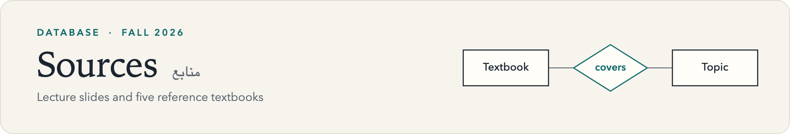
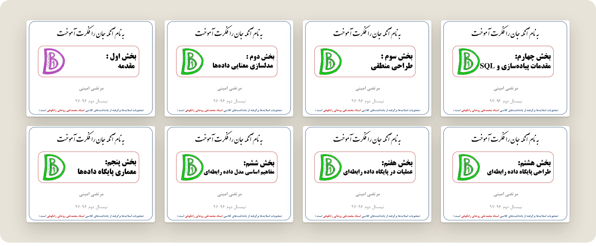
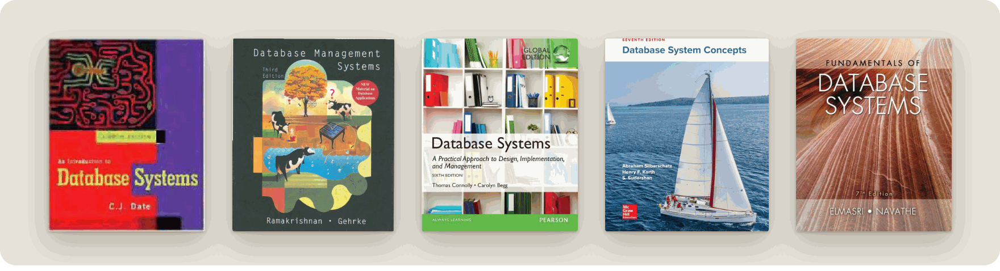

<picture>
  <source media="(prefers-color-scheme: dark)" srcset="../assets/banner-sources-dark.png">
  
</picture>

 

This folder holds the lecture slides and the reference textbooks for the course. The slides are the primary material. The textbooks are supplementary references for reviewing concepts, working through extra examples and going deeper.

[Back to the course overview](../README.md)

## Lecture slides

[**Course slides**](<course slides.pdf>) &nbsp;·&nbsp; 447 pages &nbsp;·&nbsp; Persian &nbsp;·&nbsp; 9.2 MB

The deck opens with a course introduction (pages 1–10), followed by eight parts.

| Part | Topic | Covers | Pages |
|:---:|:---|:---|---:|
| 1 | Introduction | File-based systems versus the database approach, system architectures | 11–52 |
| 2 | Semantic data modeling | ER and extended ER: attributes, weak entities, IS-A, IS-A-PART-OF | 53–119 |
| 3 | Logical design | Turning a conceptual model into tables | 120–145 |
| 4 | Implementation and SQL | Defining and altering tables, querying one or several tables | 146–188 |
| 5 | Database architecture | Internal and external views, operations on views, data independence | 189–251 |
| 6 | The relational model | Domains, relations, keys, referential integrity, constraints | 252–316 |
| 7 | Relational operations | Relational algebra and relational calculus | 317–357 |
| 8 | Relational design | Mapping ER to relations, functional dependencies, normal forms through 5NF | 358–447 |

## Reference textbooks

| Title | Authors | Edition | Pages | Size |
|:---|:---|:---:|---:|---:|
| [An Introduction to Database Systems](<An Introduction to Database Systems.pdf>) | C. J. Date | 8th,&nbsp;2003 | 1,034 | 18.1&nbsp;MB |
| [Database Management Systems](<Database Management Systems.pdf>) | Raghu Ramakrishnan, Johannes Gehrke | 3rd,&nbsp;2002 | 1,098 | 20.1&nbsp;MB |
| [Database Systems: A Practical Approach to Design, Implementation, and Management](<Database System A Practical Approach to Design Implementation and Management.pdf>) | Thomas Connolly, Carolyn Begg | 6th,&nbsp;2014 | 1,442 | 23.0&nbsp;MB |
| [Database System Concepts](<Database System Concepts.pdf>) | Abraham Silberschatz, Henry F. Korth, S. Sudarshan | 7th,&nbsp;2020 | 1,373 | 16.3&nbsp;MB |
| [Fundamentals of Database Systems](<Fundamentals of Database Systems.pdf>) | Ramez Elmasri, Shamkant B. Navathe | 7th,&nbsp;2015 | 1,273 | 4.5&nbsp;MB |

The textbooks account for most of the repository's size. To download the course without them, see [Getting the files](../README.md#getting-the-files).

## Credits

The lecture slides were prepared by Morteza Amini (Sharif University of Technology, course 40384), based on class notes by Prof. Mohammad-Taghi Rowhani Rankouhi. The textbooks remain the property of their authors and publishers.
