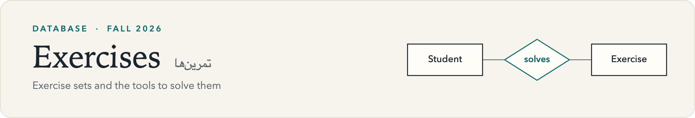
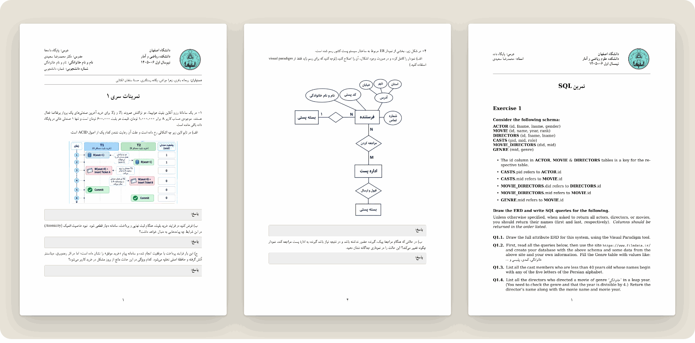

<picture>
  <source media="(prefers-color-scheme: dark)" srcset="../assets/banner-exercises-dark.png">
  
</picture>

 

This folder holds the course exercise sets, plus guides to the two tools you need to complete them.

[Back to the course overview](../README.md)

## Exercise sets

| Set | Topics | File |
|:---|:---|:---|
| Exercise&nbsp;1 | Transactions and ACID, client-server architectures, ER modeling | [EXC-1](EXC-1.pdf) |
| Exercise&nbsp;2 | SQL: ERD, building a database, and queries | [EXC-2](EXC-2.pdf) |

### Exercise 1

Four questions, written in Persian.

1. **Transactions.** Two concurrent transactions buy the last seat on a flight. Identify what goes wrong in the given timeline and which ACID property is violated, then reason about a crash during payment and a data-center failure after a confirmed purchase.
2. **Architectures.** A university course-registration system fails under load. Explain how moving from a two-tier to a three-tier client-server architecture helps, and how a multi-client, multi-server design would scale to 100 universities.
3. **ER modeling.** Draw the ER diagram of a library.
4. **ER modeling.** Complete and correct a partial ER diagram of a national postal system, then extend it for deliveries where the recipient is not home.

### Exercise 2

An SQL exercise on a movie database with six tables: `ACTOR`, `MOVIE`, `DIRECTORS`, `CASTS`, `MOVIE_DIRECTORS` and `GENRE`. The questions are in English.

- **Q1.1** Draw the full-attribute ERD.
- **Q1.2** Build the database with data from [filmdata.ir](https://www.filmdata.ir/) and your own entries.
- **Q1.3–Q1.16** Write the queries: filtering, joins, grouping and aggregation, distinct counts, and percentages by year.
- A closing question to ponder: how would you compute each actor's Bacon number?

## How to work on the exercises

- Write your answers in LaTeX, inside the provided template. Keep its structure and fill in only the answer areas.
- Draw all ER diagrams in Visual Paradigm. The exercises ask for this tool only.

## Tool guides

| Guide | What it covers |
|:---|:---|
| [Basic LaTeX](<Tools/LaTeX.md>) | Text formatting, equations, lists, matrices, sets and logic, with tutorials for getting started |
| [Visual Paradigm](<Tools/Visual Paradigm.md>) | Building an ER diagram step by step, from entities and keys to relationships and foreign keys |

See [Tools](Tools/) for an overview of both.
