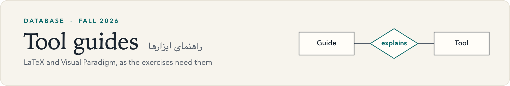
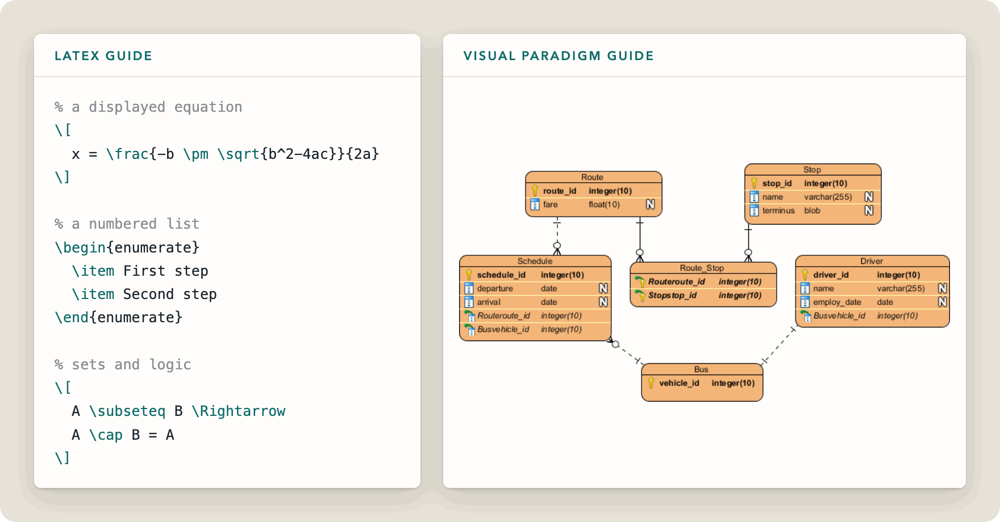

<picture>
  <source media="(prefers-color-scheme: dark)" srcset="../../assets/banner-tools-dark.png">
  
</picture>

 

Short guides to the two tools used in the exercises. Each covers only what the exercises need, so you can learn just enough and look up the rest as you go.

[Back to the exercises](../README.md) &nbsp;·&nbsp; [Course overview](../../README.md)

## [Basic LaTeX](LaTeX.md)

A quick reference for writing answers inside the exercise template.

- Learning resources: Overleaf's video series, *Learn LaTeX in 30 Minutes*, and a freeCodeCamp tutorial
- Writing text: paragraphs, bold, italics, underline and special characters
- Mathematical expressions: inline and displayed equations, fractions, Greek letters, sums and aligned equations
- Lists, matrices, sets and logical expressions

## [Visual Paradigm](<Visual Paradigm.md>)

A step-by-step walkthrough for drawing ER diagrams, based on Visual Paradigm's database design tutorial.

1. Create a project and an Entity Relationship Diagram
2. Add entities and attributes (columns)
3. Define primary keys
4. Draw one-to-one, one-to-many and many-to-many relationships
5. Review the foreign keys Visual Paradigm generates
6. Arrange the diagram so it reads clearly

| | |
|:---:|:---:|
|  |  |
| Entities on the canvas | A one-to-many relationship |
